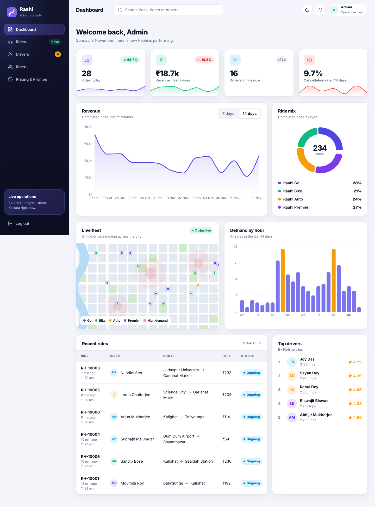
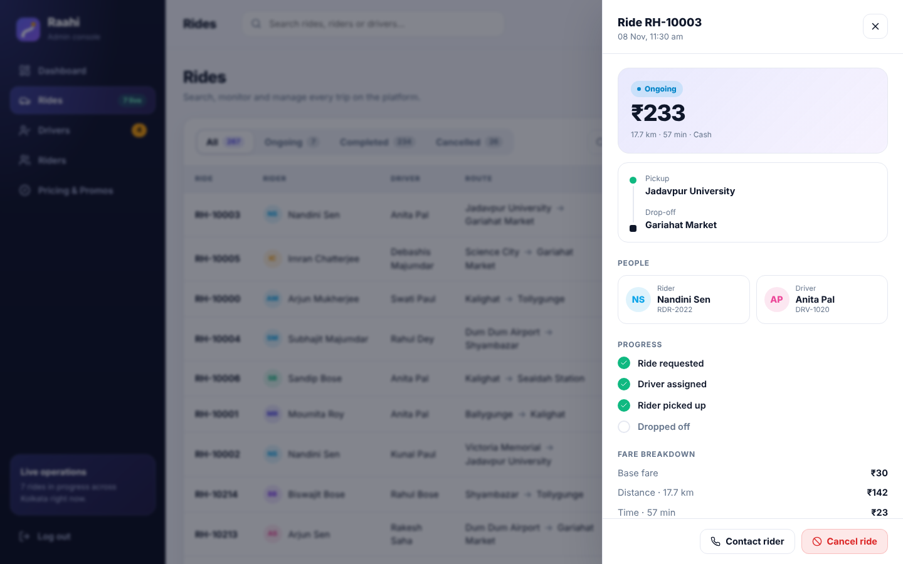
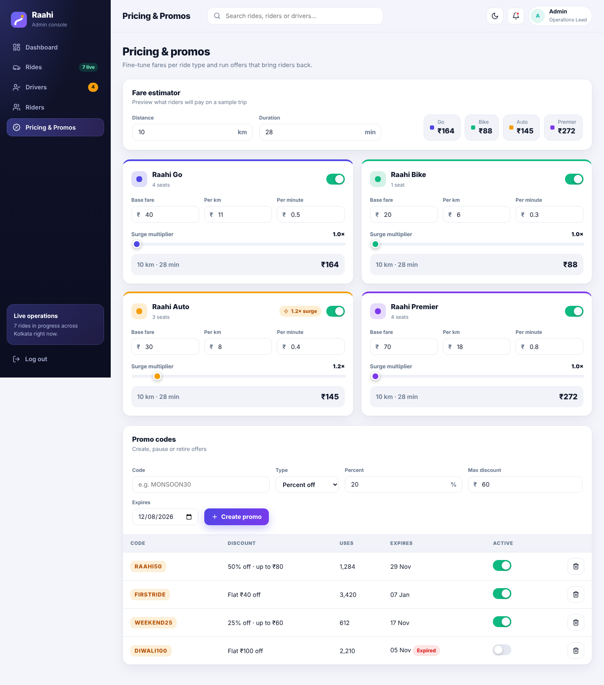
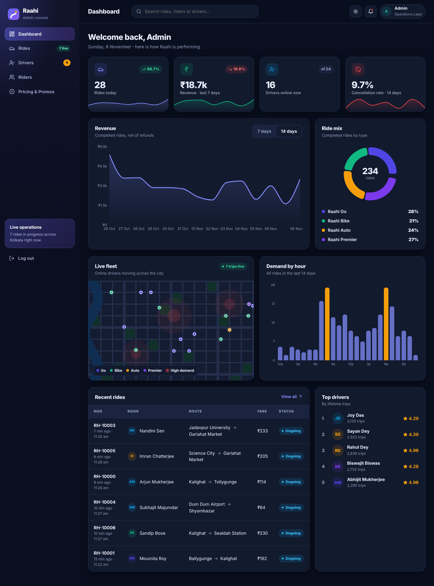
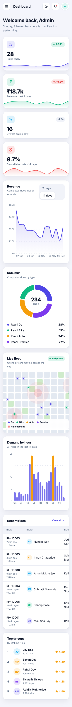

# Raahi Admin

A modern operations console for **Raahi**, a ride-sharing platform ([Flutter rider app](../raahi)). Built with React 18 and Vite.



## Features
- **Dashboard**: KPI cards with sparklines, revenue trend (7/14 days), ride mix donut, demand-by-hour chart, animated live-fleet map and recent rides.
- **Rides**: search, filter, sort and paginate; detail drawer with fare breakdown; cancel ongoing rides, refund completed ones; CSV export.
- **Drivers**: onboarding queue (approve/reject), suspend/reinstate, status tabs and search.
- **Riders**: browse, block/unblock, trip history.
- **Pricing & promos**: edit fares and surge per ride type with a live fare estimator; create, pause and delete promo codes.
- Light/dark theme, responsive layout with off-canvas sidebar, toast feedback, login gate.

| Rides | Pricing | Dark | Mobile |
|---|---|---|---|
|  |  |  |  |

## Tech
React 18, Vite 5, React Router 6 (HashRouter, so it works on GitHub Pages), Recharts, lucide-react, Vitest + Testing Library.

## Run
```bash
npm install
npm run dev      # http://localhost:5173
npm test
npm run build
```

**Demo login:** `admin@raahi.app` / `admin123`

> All data is generated locally with a seeded generator (Kolkata-based). There is no backend; changes live in memory for the session.

## Deploy
Push to GitHub, then **Settings → Pages → Source: GitHub Actions**. The included workflow tests, builds and publishes on every push to `main`. Link the resulting URL from your portfolio.
